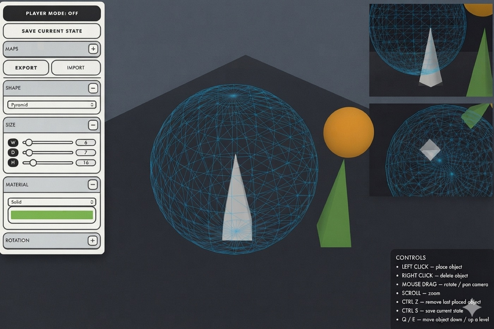

# Mörk Borg Map Builder

An isometric 3D map editor for tabletop RPG sessions, styled after the *Mörk Borg* aesthetic. Build dungeon and location maps from blocks, save them in the browser, and switch to **Player mode** to show the map to your table with a VHS/CRT effect.

**▶ Live demo:** https://liza-uchaneva.github.io/mork-borg-map-builder/



## Features

- **Block placement on an isometric grid**: box, sphere, cone, cylinder and pyramid shapes with adjustable width, depth, height, rotation, color and render style (solid / wireframe / both)
- **Multi-level building**: move between vertical levels with `Q` / `E`, with a ghost preview and ground projection of the next block
- **Inspector cameras**: collapsible top and side views alongside the main orbit camera
- **Undo history**: `Ctrl/Cmd + Z`
- **Saved maps**: save, load and delete maps in `localStorage` (`Ctrl/Cmd + S` to save)
- **Import / export**: maps serialize to a versioned JSON format, with validation on import
- **Player mode**: hides the editor UI and adds an animated VCR noise + scanline overlay for presenting at the table

## Controls

| Action | Input |
|---|---|
| Place block | Left click |
| Delete block | Right click |
| Rotate / zoom camera | Drag / scroll |
| Level down / up | `Q` / `E` |
| Undo | `Ctrl/Cmd + Z` |
| Save map | `Ctrl/Cmd + S` |

## Tech stack

- **TypeScript** + **Vite**
- **Three.js**: rendering, raycasting for picking and placement, `InstancedMesh`
- Canvas 2D for the VCR overlay
- GitHub Actions → GitHub Pages deployment

## Project structure

```
src/
  main.ts            app wiring: scene, input, history, player mode
  scenes/            main scene, inspector cameras, VCR overlay
  objects/           ghost preview + ground projection
  utils/             geometry building, placement, picking,
                     map file import/export, localStorage persistence
  ui/                editor controls
```

## Running locally

```bash
npm install
npm run dev
```

## Roadmap

- Backend persistence (accounts, cloud-saved maps, shareable links)
- Textures and prefab rooms
